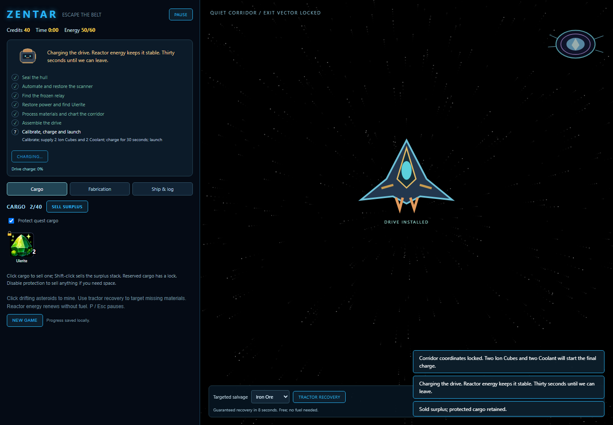
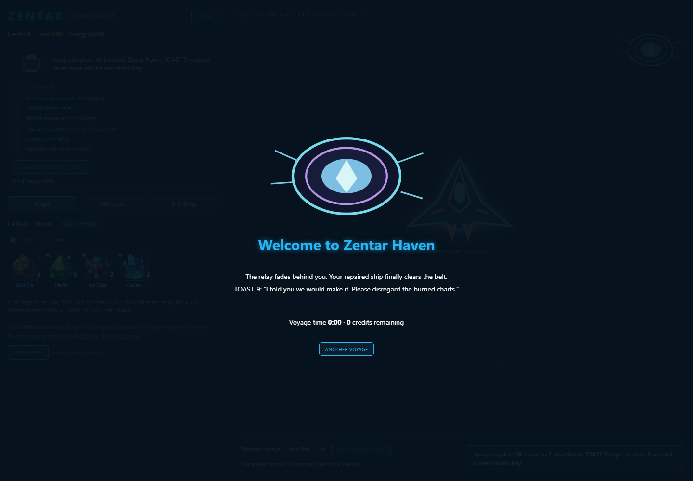

# Zentar: Escape the Belt

An asteroid-mining and ship-repair campaign. Your ship is stranded in the outer
belt; its talking toaster, TOAST-9, is the acting chief engineer. Repair the hull,
restore industry, discover a safe warp corridor and jump to Zentar Haven.

Open **index.html** directly in a browser, or use any static HTTP server.
No installation, build, CDN or network connection is required. The original
starfield and comic resource sheet remain in use. Obsolete prototypes, Python
generation helpers and unused YAML catalogs have been removed.

## Voyage

1. Mine asteroids or use targeted tractor recovery. Craft six Iron Plates and
   two Wire, then repair the hull.
2. Build a Drone and Scanner. Sell surplus for 25 credits and survey the Frozen
   Relay to discover Ice Crystal.
3. Build a Reactor. It generates renewable energy, not credits. The second
   survey costs 75 credits and reveals Ulerite.
4. Install a Refinery and Fabricator. The third survey costs 150 credits and
   reveals Sunstone, Plasma Orbs and the Quiet Corridor.
5. Refine Ulerium, prepare coolant, fabricate a Navigation Core and install
   Plasma Containment. Stabilize a Plasma Core and assemble the Warp Drive.
6. Calibrate with 10 energy. Supply two Ion Cubes and two Coolant, charge for
   30 simulation seconds, then press Launch. Building the drive does not win.

The final drive costs three Ulerium Ingots, one Navigation Core, one Stable
Plasma Core, two Sunstones, 40 energy and 3,000 credits. Blueprints list the
intermediate recipes. A single processing bay consumes energy at the start;
completed output waits if cargo is full.

## Controls and recovery

Click drifting asteroids to collect them. Cargo buttons sell one unit, or the
surplus stack with Shift. Sell surplus and individual selling honor Protect
quest cargo, enabled by default. Reserved items have a lock. Disable protection
to deliberately sell them or free space. Unlocked raw materials remain recoverable.

Tractor recovery guarantees one chosen unlocked raw material in eight seconds,
then recharges for four seconds. It costs no fuel or credits and waits if cargo
is full. This makes progress possible even with unlucky asteroid spawns. The
Reactor also needs no fuel. Cargo Pods add 20 cargo slots and ten energy
capacity each, up to four pods. Two Reinforced Cargo Racks can add 40 slots
each after the Fabricator is installed. Maximum cargo capacity is 200. Drones mine; Scanners improve spawn frequency.

Cargo, Fabrication, and Ship & log tabs organize the panel. Blueprint filters
show ready recipes, machines, or materials. P, Escape, or Pause stops processing,
surveys, salvage and charging. The decorative starfield continues. Small screens
place the mining field above the scrollable ship panel.

Progress autosaves every three seconds in localStorage. Surveys, processing,
recovery and charging resume from remaining simulation time; no offline-time
production. Old cargo, machines, credits and completed victories are retained.
Unfinished old saves gain new surveys and drive commissioning. Browser storage
availability varies.

## Implementation and checks

- `campaign-data.js`: items, atlas mapping, recipes and survey content.
- `campaign-core.js`: simulation, gates, cargo protection and persistence.
- `campaign.js`: UI, mining interaction and campaign presentation.
- `space.js`: preserved original starfield and sound playback.
- `media/art/`: new SVG ship, toaster, beacon, warp, wire and circuit art.

Run `node tests/test-campaign.cjs`. The end-to-end check starts with empty cargo and
no random spawns, acquires every material through recovery, crafts every
required system, pays all fees, resumes charging from a save and launches.
It also checks full-cargo recovery, protection, pause and old-save migration.
The recovery-only route takes about 26 simulation minutes; mining and Drones
can shorten it. The old YAML catalogs were historical concepts and have been removed.

## Credits

See [asset credits and provenance](ATTRIBUTION.md) for the original resource
sheet, sound effects, starfield source and new SVG illustrations. Repository
prompts suggest the resource sheet was AI-generated, but its exact origin
is not confirmed. No artist name or license has been invented for it.

## Languages

Use the Czech/English switch on the welcome screen or in the ship header.
The language preference is saved separately from your voyage; switching never
changes inventory, recipes, progress or save identifiers. Interface labels,
item names, mission guidance, TOAST-9 dialogue and the ending are translated.
Credits/provenance documentation remains in English. Czech browsers default
to Czech unless another language was previously selected.

On phones, the field stays above a compact ship panel with accessible system
tabs. Mission objectives and help collapse by default; open either heading
to read more. Cargo and blueprints scroll inside their own panel. Touch targets
are enlarged; short landscape screens use a side-by-side layout. In Czech,
raw Ulerite is displayed as "ulerium".

The Cargo tab shows the next storage upgrade, its ingredients and build limit.
Cargo Pods cost four Iron Plates each and need no powered machinery. Reinforced
Cargo Racks cost six Iron Plates, two Circuits and 15 energy each; they require
a Fabricator and survey 2. Capacity progresses from 40 to 120 with four pods,
then to 200 with two racks. The Fabrication filter also lists Cargo upgrades.
A full hold can still craft an expansion using ingredients already aboard.
Old saves retain their machines and cargo, but bonuses obey the new limits.

If protected cargo fills the hold, **Free cargo space** opens automatically.
Choose an item and quantity, then confirm its sale. Only those units are released;
global protection and the rest of the cargo are unchanged. Protection reserves
bounded campaign quantities rather than all duplicates indefinitely. Sell surplus
can sell amounts beyond those reserves. Drones now leave four cargo slots free
so automatic collection cannot immediately refill every slot you clear.
